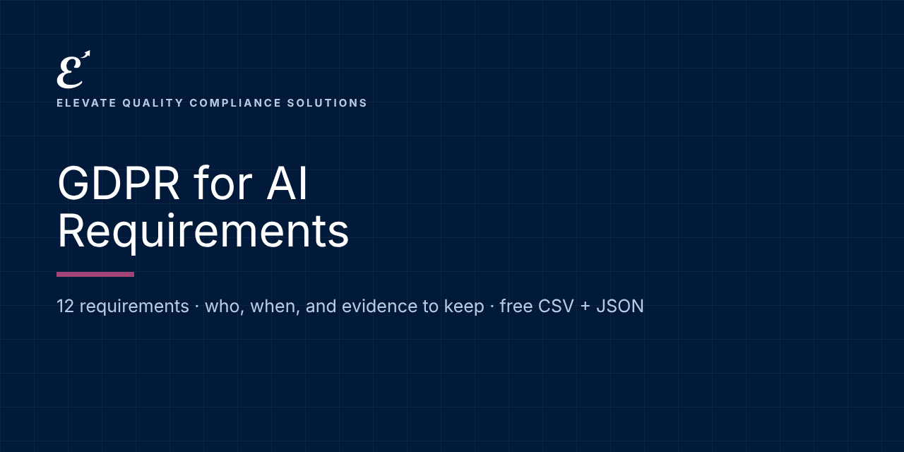

# GDPR for AI: Requirements and Evidence

   

**Free, machine-readable GDPR for AI requirements in plain language: who each one applies to, when it applies, and examples of the evidence to keep.** CSV and JSON, ready for Excel, Google Sheets, GRC tools or your own code.

Maintained by [Elevate Quality Compliance Solutions](https://elevateqcs.com). If this saves you time, please ⭐ star the repo so others can find it.

**Source:** Regulation (EU) 2016/679 (GDPR) as it applies to AI, with EDPB Opinion 28/2024.
**Official text:** https://eur-lex.europa.eu/eli/reg/2016/679/oj

## Key dates
| Date | What applies |
|---|---|
| 2018-05-25 | GDPR applies |
| 2024-12-17 | EDPB Opinion 28/2024 on AI models |

## How to use it (2 minutes)
1. **Browse online:** [https://elevate-qcs.github.io/gdpr-ai-requirements/](https://elevate-qcs.github.io/gdpr-ai-requirements/) and search or filter.
2. **Spreadsheet:** download [`data/requirements.csv`](data/requirements.csv), open it in Excel or Google Sheets, and add columns for status, owner and evidence location. That's your gap assessment.
3. **Code and GRC tools:** load [`data/requirements.json`](data/requirements.json) (format: [`schema/`](schema/requirement.schema.json); examples: [`examples/`](examples/)).

Full guide: [docs/HOW-TO-USE.md](docs/HOW-TO-USE.md) · [FAQ](docs/FAQ.md)

## Requirements (12)
Applies to: controller, processor

| Reference | Requirement | Applies to | From | Evidence examples |
|---|---|---|---|---|
| Art. 5 | **Data protection principles for AI**: Apply lawfulness, fairness, transparency, purpose limitation, minimization, accuracy, storage limitation, security and accountability to training and use. | controller | 2018-05-25 | Principles assessment per AI system. |
| Art. 6 | **Lawful basis**: Identify a lawful basis for each processing purpose in development and deployment; legitimate interest needs a documented three-step test (EDPB Opinion 28/2024). | controller | 2018-05-25 | Legitimate interest assessments; lawful basis register. |
| Art. 9 | **Special category data**: Process sensitive data only under an Article 9(2) condition; see also AI Act Art. 4a for bias correction. | controller | 2018-05-25 | Article 9 justification; safeguards. |
| Art. 13-14 | **Transparency to individuals**: Tell people how their data is used for AI, including sources when not collected from them. | controller | 2018-05-25 | Privacy notices covering AI. |
| Art. 15-21 | **Data subject rights**: Handle access, rectification, erasure and objection requests, including for training data where applicable. | controller | 2018-05-25 | Rights request log and procedure. |
| Art. 22 | **Automated decision-making**: Respect limits on solely automated decisions with legal or similar effects; offer human intervention and the right to contest. | controller | 2018-05-25 | Human review process; notices. |
| Art. 25 | **Data protection by design and default**: Build privacy into AI design: minimization, pseudonymization, access limits. | controller | 2018-05-25 | Design reviews; privacy controls. |
| Art. 28 | **Processors**: Contracts with AI vendors processing personal data on your behalf. | controller, processor | 2018-05-25 | Data processing agreements. |
| Art. 30 | **Records of processing**: Record AI processing activities. | controller | 2018-05-25 | Updated record of processing activities. |
| Art. 32 | **Security**: Appropriate security for AI data and models, including AI-specific attacks. | controller | 2018-05-25 | Security assessment. |
| Art. 35 | **Data protection impact assessment**: Run a DPIA for high-risk AI processing; can be linked to the AI Act FRIA. | controller | 2018-05-25 | DPIA with FRIA cross-references. |
| EDPB 28/2024 | **Anonymity of AI models**: Do not assume a model trained on personal data is anonymous; assess case by case. | controller | 2018-05-25 | Model anonymity assessment. |

## Implementation kit (launching soon)
This repository tells you **what** is required. Our GDPR for AI implementation kit gives you **ready-to-adapt documents** to do it: policies, procedures, forms, workbooks, a Kit Navigator and training, mapped to these requirements.
**[Join the launch list](https://elevateqcs.com/coming-soon)** to be notified.

## Disclaimer
This repository is general information to help you understand and organize work on AI governance frameworks. It is not legal advice and does not guarantee compliance, certification or any regulatory outcome. Requirements are summarized in our own words; always check the official texts and get qualified advice for your situation.

## Corrections and contributions
Spotted an error or a change? [Open a correction](../../issues/new?template=correction.md) with a link to the official source. See [CONTRIBUTING.md](CONTRIBUTING.md).

## Reuse and citation
Free under [CC BY 4.0](LICENSE), including commercially, with credit: *"GDPR for AI Requirements by Elevate Quality Compliance Solutions (elevateqcs.com)"*. See [CITATION.cff](CITATION.cff).

## More open requirements from ElevateQCS
[ISO 9001:2026](https://github.com/elevate-qcs/iso-9001-2026-requirements) · [ISO 14001:2026](https://github.com/elevate-qcs/iso-14001-2026-requirements) · [ISO/IEC 27001:2022](https://github.com/elevate-qcs/iso-27001-2022-requirements) · [NIS2](https://github.com/elevate-qcs/nis2-requirements) · [DORA (Financial Entities)](https://github.com/elevate-qcs/dora-financial-entities-requirements) · [DORA (ICT Providers)](https://github.com/elevate-qcs/dora-ict-providers-requirements) · [EU AI Act](https://github.com/elevate-qcs/eu-ai-act-requirements) · [ISO/IEC 42001](https://github.com/elevate-qcs/iso-42001-requirements) · [NIST AI RMF](https://github.com/elevate-qcs/nist-ai-rmf-requirements)
